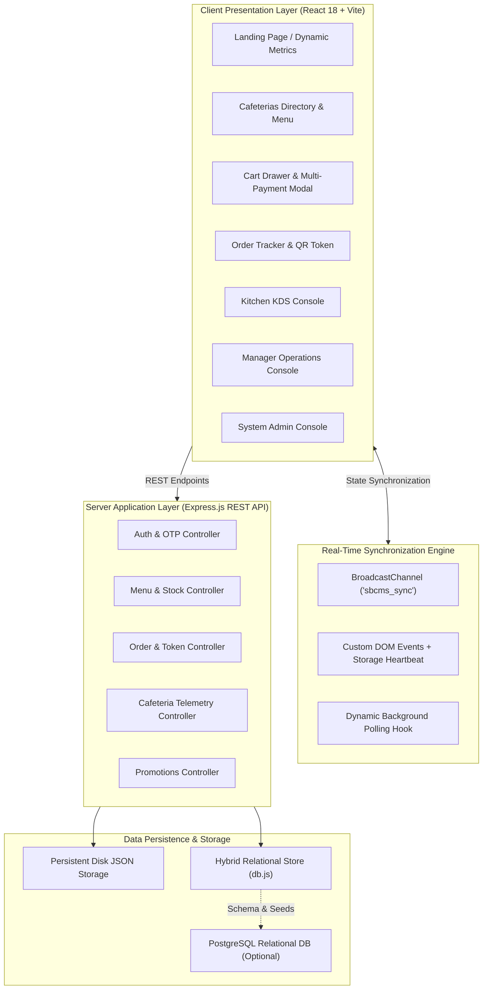

<<<<<<< HEAD
# 🍽️ Smart BUP Cafeteria Management & Digital Ordering System (SBCMS)

[](https://react.dev/)
[](https://vitejs.dev/)
[](https://nodejs.org/)
[](https://expressjs.com/)
[](https://www.postgresql.org/)
[](#-dual-theme-design-system)
[](https://bup.edu.bd/)
[](LICENSE)

An enterprise-grade, full-stack campus dining automation and real-time food ordering ecosystem engineered specifically for **Bangladesh University of Professionals (BUP)**. 

The system solves peak lunch-rush congestion between university classes by integrating live queue telemetry, pre-order tokenization, counter pickup, kitchen display automation, and comprehensive role-based operational management for campus members and cafeteria administrators.

---

## 📌 Project Overview & Description

**Short Description:**
> Smart campus dining automation and digital food ordering system for Bangladesh University of Professionals (BUP) — live queue wait-times, role-based KDS/manager consoles, OTP verification, and dual-theme UI.

**Core Vision:**
In a busy university campus, students and faculty often face long dining counter queues, unexpected out-of-stock items, and rushed lunch breaks. **SBCMS** unifies all four campus cafeterias under one responsive, zero-latency digital umbrella. University members can browse daily freshly prepared specials, inspect live queue wait times, pre-order meals with multiple payment methods (bKash, Nagad, Student ID Card, or Cash on Pickup), and walk straight to dedicated express pickup counters using a digital QR token.

---

## ✨ Key Features

### 🎓 1. Campus Member Experience (Students, Faculty, Officers)
- **Live Cafeteria Directory**: Instant status overview of all 4 campus dining halls:
  - **Vista Cafeteria** (Central Dining Complex)
  - **Amitie Cafeteria** (Student Center, Level 2)
  - **Pitstop Canteen** (Academic Building South)
  - **Monpura / 3rd Place** (Faculty & Executive Lounge)
- **Real-Time Dining Telemetry**: Dynamic metrics displaying shortest kitchen queue, rush hour indicators, and open vs. paused kitchens.
- **Interactive Food Catalog**: Filter meals by category (*Rice & Biryani, Snacks, Beverages, Bakery, Curries, Specials*), customize quantity, and view calorie counts & allergen tags.
- **Multi-Gateway Payment Integration**:
  - 📱 **bKash Mobile Banking** (Real-time simulated mobile wallet gateway)
  - 📲 **Nagad Digital Payment**
  - 💳 **BUP Student / Employee Smart Card** (Campus balance debit)
  - 💵 **Pay on Counter** (Reserve token & pay cash upon tray collection)
- **Digital Order Tracking & QR Verification**: Real-time order tracking (*Pending $\rightarrow$ Preparing $\rightarrow$ Ready for Pickup $\rightarrow$ Completed*) with a scannable verification QR code and printable pickup slip.

### 🛡️ 2. Multi-Persona Authentication & RBAC
- **Strict Role-Based Access Control**:
  - `student`: Standard campus ordering, order tracking, review submissions.
  - `faculty`: Academic dining privileges, faculty lounge access.
  - `officer`: Administrative staff dining account.
  - `cafeteria_staff`: Kitchen Display System (KDS) order pipeline.
  - `cafeteria_manager`: Dining console, menu stock editing, queue wait adjustments.
  - `admin`: System-wide master console, promotional code creation, refund audits.
  - `guest`: Temporary 7-day self-expiring dining pass for campus visitors & seminar guests.
- **Dual-Factor Security**: 6-digit OTP verification powered by **Nodemailer SMTP** (with local dev console fallback).
- **Fast Evaluation Role Switcher**: One-click demo account switcher in the navigation bar for evaluation and grading.

### 👨‍🍳 3. Kitchen Display System (KDS — Staff Portal)
- **Live Kitchen Order Kanban**: Real-time incoming orders stream directly to kitchen tablets/screens.
- **One-Tap Order Stage Updates**: Move orders through *Preparing*, *Ready for Counter Call*, and *Handed Over*.
- **Integrated QR Scanner**: Kitchen staff can scan student pickup QR codes using a built-in camera scanner modal to complete pickups in seconds.

### 📊 4. Manager Dining Operations Console
- **Instant Emergency Controls**: Toggle entire cafeteria Open/Closed status with a single switch.
- **Queue Wait-Time Telemetry Adjuster**: Adjust live queue estimates ($\le$5 min, 10 min, 20 min) reflected across the entire student website in real time.
- **Live Inventory & Stock Manager**: Add, edit, or adjust food item stock counts; automated out-of-stock lockout prevents overselling.
- **Daily Performance & Revenue Analytics**: Track orders completed, daily takings, and popular item trends.

### 👑 5. System Administrator Console
- **Campus Canteen Auditing**: Global visibility over all four university cafeterias.
- **Promotional Coupon Management**: Create percentage and flat-rate discount vouchers with usage limits and expiration dates.
- **Refund & Dispute Audits**: Review customer cancellation requests and approve instant wallet refunds.

### 🎨 6. Dual-Theme Design System
- **Campus Paper Light Mode**: Warm, academic palette featuring BUP Teal (`#0f766e`), Warm Paper (`#fbf9f5`), and Golden Mustard accents.
- **Executive Midnight Obsidian Dark Mode**: Deep slate background (`#090d16`), vibrant cyan-teal glow (`#2dd4bf`), high-contrast typography, and zero-flicker CSS transitions.
- **Smooth Interaction Physics**: GPU-composited mechanical button press feedback (`scale(0.96) translateY(1px)`), smooth scroll spy, and slide-down mobile navigation panel.

---

## 🏛️ System Architecture



---

## 💻 Tech Stack

| Domain | Technology | Description |
|---|---|---|
| **Frontend** | React 18 | Declarative component architecture with modern Hooks |
| **Build Tool** | Vite 5 | Lightning-fast HMR and optimized production bundling |
| **Routing** | React Router v6 | Declarative client routing with protected role gates |
| **Styling** | Custom CSS3 | GPU-accelerated design tokens, CSS variables, dark mode engine |
| **Backend** | Node.js + Express | Robust REST API server with JWT authentication & RBAC middleware |
| **Security** | JWT & Bcrypt | Stateless cryptographic session tokens and secure credential hashing |
| **Email Service** | Nodemailer | SMTP client dispatching live OTP verification codes |
| **Persistence** | Hybrid Relational / Disk JSON | Dual-mode storage: zero-dependency in-memory DB + disk sync + PostgreSQL support |
| **Icons & Extras**| SVG Icons & Canvas Confetti | Custom SVG icon registry & celebrations on successful order placement |

---

## 🚀 Quick Start Guide

### Prerequisites
- **Node.js** (v18.0.0 or higher recommended)
- **npm** (v9.0.0 or higher)
- **Git**

### 1. Clone the Repository
```bash
git clone https://github.com/<your-username>/<your-repo-name>.git
cd sbcms-module1
```

### 2. Backend Setup
```bash
cd backend
npm install

# Create environment configuration from template
cp .env.example .env

# Start the Express server
npm run dev
```
*The backend API will run on **`http://localhost:5000`**.*

> 💡 **Tip:** If you do not configure an SMTP email in `.env`, the server will automatically print all generated OTP codes directly to your terminal console for instant local testing!

### 3. Frontend Setup
Open a new terminal window:
```bash
cd frontend
npm install

# Create environment configuration from template
cp .env.example .env

# Start the Vite development server
npm run dev
```
*The web application will launch at **`http://localhost:5173`**.*

---

## 🔑 Pre-Seeded Evaluation Accounts

To facilitate immediate testing and demonstration, the database comes pre-populated with active accounts across all user roles:

| Role | Portal / Route | Identifier / Email | Default Password |
|---|---|---|---|
| **Student** | `/login` | `2021-1-60-001` or `sarah.rahman@bup.edu.bd` | `password123` |
| **Faculty** | `/login` | `FAC-101` or `tanvir.ahmed@bup.edu.bd` | `password123` |
| **Officer** | `/login` | `OFF-301` or `rafiqul.islam@bup.edu.bd` | `password123` |
| **Kitchen Staff** | `/staff/login` | `STF-001` | `password123` |
| **Dining Manager** | `/manager/login` | `MGR-001` | `password123` |
| **System Administrator** | `/admin/login` | `ADM-001` | `password123` |
| **Guest Pass** | `/guest` | Self-register with any personal email | Instant OTP |

*(You can also use the **Evaluation Role Switcher** dropdown directly inside the navbar to switch personas instantly with a single click!)*

---

## 📁 Repository Directory Structure

```text
sbcms-module1/
├── README.md                           # Master Project Documentation
├── .gitignore                          # Standard Node/React Git ignore rules
│
├── backend/                            # Express.js REST API Server
│   ├── .env.example                    # Backend environment template
│   ├── package.json                    # Dependencies & scripts
│   ├── server/
│   │   ├── server.js                   # Application entry point & route registration
│   │   ├── db.js                       # Hybrid In-Memory & PostgreSQL database client
│   │   ├── controllers/                # Request handlers (auth, orders, menu, cafeteria, promo)
│   │   ├── middleware/                 # JWT authentication, RBAC, canteen access guards
│   │   ├── models/                     # Business logic models with disk persistence
│   │   ├── routes/                     # REST API route endpoints
│   │   └── utils/                      # Token generation & Nodemailer OTP dispatch
│   └── database/
│       ├── schema.sql                  # PostgreSQL DDL table definitions
│       ├── seeds.sql                   # Initial cafeteria and menu seeds
│       └── persistent_*.json           # Auto-synced disk databases (menu, orders, users)
│
└── frontend/                           # React 18 + Vite Application
    ├── .env.example                    # Frontend environment template
    ├── index.html                      # HTML template with Google Fonts
    ├── package.json                    # Dependencies & scripts
    ├── vite.config.js                  # Vite configuration
    └── src/
        ├── App.jsx                     # Route architecture & smooth scroll controller
        ├── main.jsx                    # Root provider mounting
        ├── index.css                   # Custom Design System, tokens & dark mode styles
        ├── assets/                     # Bundled cafeteria photos & campus media
        ├── components/                 # Modals, Navbar, Cards, Hero, ThemeToggle, QR Scanner
        ├── context/                    # AuthContext, CartContext, OrderContext, ThemeContext
        ├── data/                       # Initial cafeteria dataset & mock configurations
        ├── pages/                      # Landing, Home, Menu, Portals (Staff, Manager, Admin)
        ├── services/                   # Axios/Fetch API client layer
        └── utils/                      # Live sync engine & live cafeterias hook
```

---

## 📡 REST API Reference (Sample)

| Method | Endpoint | Description | Access |
|---|---|---|---|
| `POST` | `/api/auth/register` | Register a new BUP student/faculty member | Public |
| `POST` | `/api/auth/login` | Authenticate campus member & receive JWT | Public |
| `POST` | `/api/auth/verify-otp` | Verify 6-digit OTP code | Public |
| `GET` | `/api/cafeterias` | Retrieve list of cafeterias with live queue status | Public |
| `PATCH` | `/api/cafeterias/:id/status` | Update cafeteria open status & queue wait time | Manager / Admin |
| `GET` | `/api/menu` | Retrieve menu catalog across all cafeterias | Public |
| `POST` | `/api/menu` | Add a new dish to cafeteria catalog | Manager / Staff |
| `POST` | `/api/orders` | Place a meal order & generate pickup token | Authenticated |
| `GET` | `/api/orders/my-orders` | Fetch active and historical orders for member | Authenticated |
| `PATCH` | `/api/orders/:id/status` | Update kitchen preparation stage | Staff / Manager |
| `POST` | `/api/promotions/apply` | Validate discount coupon code on checkout | Authenticated |

---

## 🛡️ License & Academic Context

This project is developed as part of academic coursework for **Software Reliability Engineering (SRE) Lab** at **Bangladesh University of Professionals (BUP)**, Mirpur Cantonment, Dhaka, Bangladesh.

Distributed under the **MIT License**.

---

<p align="center">
  <b>Designed with ❤️ for Bangladesh University of Professionals (BUP)</b><br>
  <sub>Streamlining campus dining, reducing queue wait times, and elevating university life.</sub>
</p>
=======
# Smart BUP Cafeteria Management & Digital Ordering System (SBCMS)

A web-based cafeteria management project designed to modernize food ordering and cafeteria operations at Bangladesh University of Professionals (BUP).

## Overview

The **Smart BUP Cafeteria Management & Digital Ordering System (SBCMS)** aims to make campus dining more convenient by reducing unnecessary queues and streamlining cafeteria services through a unified digital platform.

The system is designed to support BUP's four cafeteria locations: Vista, Amitie, Third Place, and PitStop. It aims to provide students with easier access to cafeteria information while giving cafeteria staff, managers, and university administrators dedicated interfaces for their respective responsibilities.

This repository currently contains **Module 1: Authentication & Landing Experience**, which establishes the application's landing page, authentication workflows, user sessions, and role-specific portals as the foundation for future modules.

## Current Features

- **Responsive Landing Page:** Introduces the system, its features, and available cafeterias.
- **User Registration:** Supports role-based registration for students, faculty, and university staff.
- **Secure Authentication:** Implements password-based login and email-based OTP verification.
- **OTP Verification:** Supports one-time password verification, resend cooldowns, and expiration handling.
- **Guest Accounts:** Allows visitors to create temporary accounts with a seven-day validity period after verification.
- **Role-Based Portals:** Provides separate login interfaces for cafeteria staff, managers, and administrators.
- **Protected Routes:** Restricts access to designated pages based on authentication and user roles.
- **Session Management:** Uses JSON Web Tokens (JWT) and browser local storage to maintain login sessions.
- **Cafeteria Selection:** Displays the four cafeteria options after login.
- **API-Ready Architecture:** Separates frontend services, backend routes, controllers, middleware, and models to support future development.

## Planned Features

The following features are part of the broader SBCMS project and may be implemented in subsequent modules:

- Live cafeteria menus, prices, and item availability.
- Shopping cart and advance food ordering.
- Digital payments through bKash and Nagad sandbox integrations.
- Pay-at-counter support.
- Automatic order token and QR code generation.
- Order tracking and pickup verification.
- Inventory management and low-stock alerts.
- Staff order-processing dashboards.
- Sales analytics, reports, and cafeteria management tools.
- Customer reviews and ratings.
- Notifications for order status updates.

> **Development status:** The current module focuses on the landing experience, authentication, and user portals. Some interfaces and cafeteria information use mock data, and the backend uses in-memory models. The planned features above should not be considered fully implemented.

## Technology Stack

| Component | Technology |
|---|---|
| Frontend | React.js |
| Build Tool | Vite |
| Routing | React Router |
| Backend | Node.js |
| API Framework | Express.js |
| Authentication | JSON Web Tokens (JWT) |
| Password Hashing | bcryptjs |
| OTP Email Delivery | Nodemailer |
| Configuration | dotenv |
| API Communication | REST API |
| Version Control | Git and GitHub |

## Project Structure

```text
sbcms-module1/
├── frontend/
│   ├── src/
│   │   ├── assets/
│   │   ├── components/
│   │   ├── context/
│   │   ├── data/
│   │   ├── pages/
│   │   ├── routes/
│   │   ├── services/
│   │   ├── App.jsx
│   │   ├── main.jsx
│   │   └── index.css
│   ├── .env.example
│   ├── package.json
│   └── vite.config.js
│
├── backend/
│   ├── server/
│   │   ├── controllers/
│   │   ├── middleware/
│   │   ├── models/
│   │   ├── routes/
│   │   ├── utils/
│   │   └── server.js
│   ├── .env.example
│   └── package.json
│
└── README.md
```

## Getting Started

Follow these steps to run the project locally.

### Prerequisites

Make sure you have installed:

- [Node.js](https://nodejs.org/) (with npm)
- [Git](https://git-scm.com/)
- A code editor such as [Visual Studio Code](https://code.visualstudio.com/)

### 1. Clone the Repository

```bash
git clone <YOUR_REPOSITORY_URL>
cd sbcms-module1
```

Replace `<YOUR_REPOSITORY_URL>` with your GitHub repository URL.

### 2. Set Up the Backend

```bash
cd backend
npm install
```

Create a `.env` file using `.env.example` as a reference.

Configure the required environment variables, including a strong JWT secret and any required email settings.

Start the backend development server:

```bash
npm run dev
```

The backend is configured to run at:

`http://localhost:5000`

### 3. Set Up the Frontend

Open a second terminal:

```bash
cd frontend
npm install
```

Create a `.env` file using `.env.example` as a reference. Configure `VITE_API_BASE_URL` to point to the backend authentication API. The default API base URL is:

`http://localhost:5000/api/auth`

Start the frontend development server:

```bash
npm run dev
```

Open the local URL printed by Vite, typically:

`http://localhost:5173`

Keep both development servers running while using the application.

## Authentication Workflow

The authentication module follows this general workflow:

1. A user registers or selects an available login method.
2. The backend validates the submitted information.
3. An OTP is generated and delivered through the configured email service, or displayed in the backend console during development.
4. The user submits the OTP for verification.
5. After successful verification, the backend issues a JWT.
6. The frontend stores the authenticated session and grants access to the appropriate pages.
7. Protected routes enforce authentication and role-based access restrictions.

Guest accounts become active after successful verification and expire after seven days.

## Development Notes

- **Database:** The current module uses in-memory data stores. User and session-related data may not persist across backend restarts.
- **Email configuration:** SMTP settings are required for actual email delivery. Without SMTP configuration, development OTPs are printed in the backend console.
- **Cafeteria information:** Some cafeteria details and landing-page content are provided through mock data.
- **Demo accounts:** Operational portals may use seeded development accounts. Check the backend model configuration for the current credentials, and replace all default credentials before deployment.
- **Payments and ordering:** Full payment processing and the complete cafeteria ordering workflow belong to the broader project scope and are not established by this module alone.

## Security Considerations

- Keep `.env` files and real credentials out of version control.
- Use strong, unique JWT secrets and operational account passwords.
- Configure HTTPS for production deployment.
- Configure email delivery and appropriate OTP expiration and rate limits.
- Replace in-memory storage with a persistent database before production use.
- Review authentication, authorization, and session handling before public deployment.

## Future Development

SBCMS is intended to evolve into a complete cafeteria management platform by integrating menu management, inventory tracking, digital ordering, payments, pickup verification, and operational analytics.

The modular architecture is intended to help these features be developed and integrated incrementally.

## Academic Project

**Project Name:** Smart BUP Cafeteria Management & Digital Ordering System (SBCMS)  
**Institution:** Bangladesh University of Professionals (BUP)  
**Department:** Information and Communication Technology (ICT)  
**Project Type:** Academic Software Development Project

### Project Team

- Md. Mahim Rana
- Didar Ibn Firoz
- Rukaiya Binte Iqbal

### Supervisors

- Nazneen Akhter — Assistant Professor, Department of ICT, FST, BUP
- Suman Saha — Assistant Professor, Department of IT & RE, FCPSE, University of Frontier Technology, Bangladesh

---

**SBCMS — Making campus dining smarter, simpler, and more efficient.**
>>>>>>> origin/main
